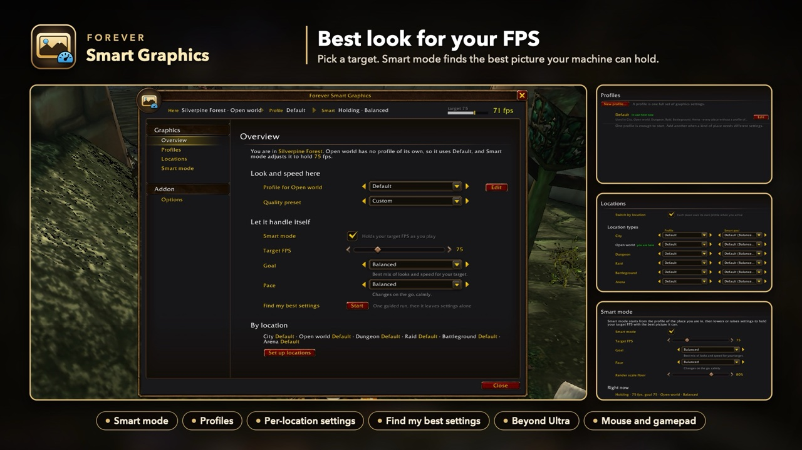
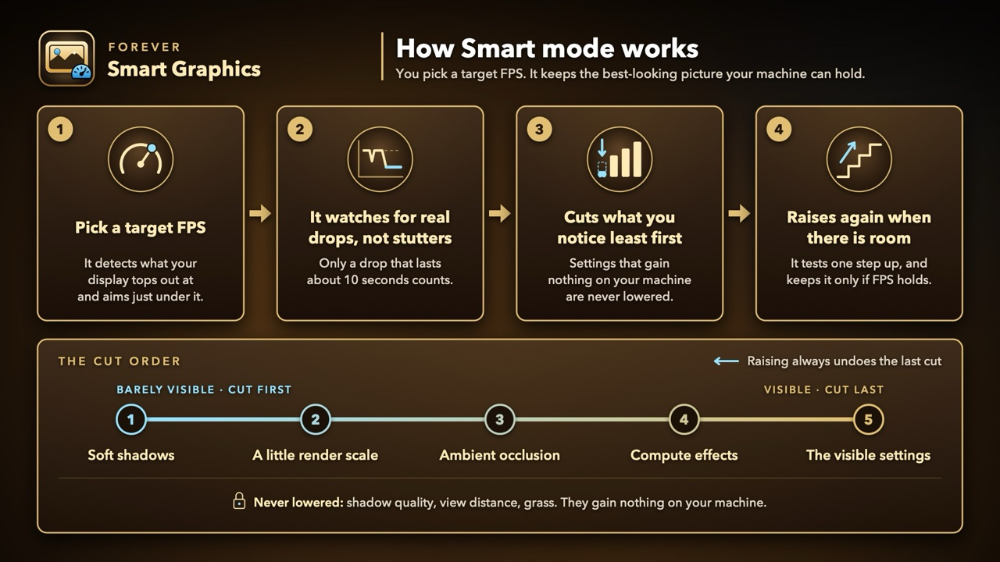
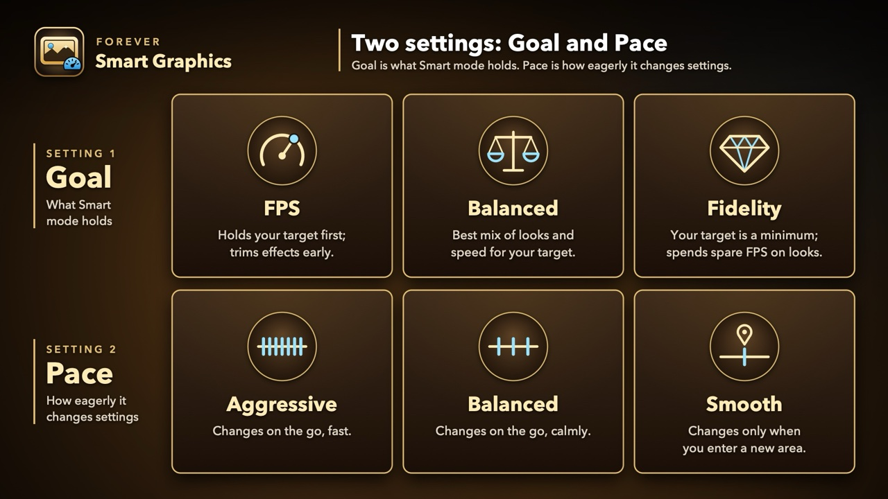
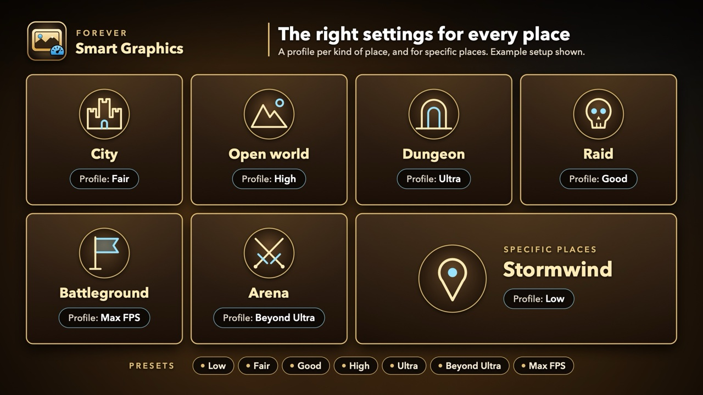
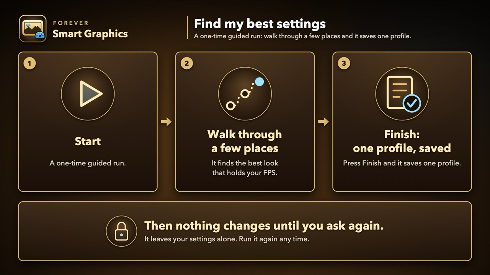
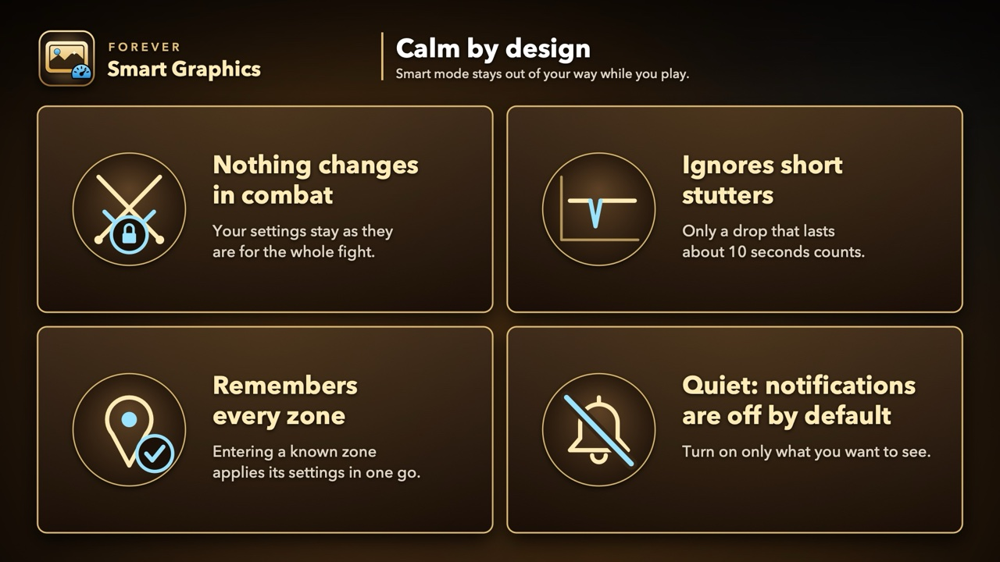

# Forever Smart Graphics

Smart graphics that adjust themselves: maximum fidelity at your target FPS, zone by zone.

**Stop tweaking graphics settings.** Tell Forever Smart Graphics the FPS you want, and it automatically tunes your game for the best picture your machine can hold. It gets sharper when there's room and lighter when things get heavy, and it never changes anything mid-fight.

Prefer full control? Build your own profiles and have them switch by themselves in cities, dungeons, raids and battlegrounds.

[CurseForge](https://www.curseforge.com/wow/addons/forever-smart-graphics) · [Releases](https://github.com/racha/forever-smart-graphics/releases) · [Issues](https://github.com/racha/forever-smart-graphics/issues)

> **Beta.** This is a test release. Please try it and report anything odd you see.



## What it does

- **Smart mode**: pick a target FPS and leave it on. It lowers the settings you notice least first, never touches the ones that gain nothing on your machine, and raises quality again when there is room.
  - **Goal**: FPS, Balanced, Fidelity or Eco (caps FPS at your target to save battery).
  - **Pace**: Aggressive (changes on the go, fast), Balanced (changes on the go, calmly) or Smooth (changes only when you enter a new area).
  - It ignores short stutters, remembers every zone, and changes nothing in combat.
- **Profiles**: every graphics setting, including hidden engine settings the Options menu doesn't show. Start from a preset (Low, Fair, Good, High, Ultra, Beyond Ultra, Max FPS), from your current settings, or empty.
- **Switch by location**: a profile for each kind of place (city, open world, dungeon, raid, battleground, arena) and for specific places such as Stormwind.
- **Find my best settings**: a one-time guided run that saves one profile and then leaves your settings alone.
- **Beyond Ultra**: every menu setting at its top plus hidden settings past the menu's Ultra.
- **FPS on the minimap**: a small readout under the zone name that pulses when the addon changes something.
- **Quiet by default**: every notification is off until you turn it on.
- **Restore**: puts back the exact settings you had before the addon, any time.

Each setting shows what it does and how much FPS it costs. The window works with mouse, keyboard and gamepad.

## How Smart mode works











## Install

Get it from CurseForge, or download the zip from Releases and unzip it into `World of Warcraft/_forever_/Interface/AddOns`. Restart the game.

## Opening it

- `/fsg`
- the minimap button
- the addon compartment (the button under the minimap)

## Slash commands

| Command | What it does |
|---|---|
| `/fsg` | open or close the window |
| `/fsg status` | where you are, the active profile, Smart state, FPS |
| `/fsg smart on\|off`, `/fsg target <fps>`, `/fsg floor <percent>`, `/fsg maxscale <percent>` | Smart mode, with its lowest and highest render scale |
| `/fsg goal <fps\|balanced\|fidelity\|eco>`, `/fsg pace <aggressive\|balanced\|smooth>` | Smart mode's goal and pace |
| `/fsg findbest <fps>`, `/fsg finish`, `/fsg stop` | Find my best settings |
| `/fsg use <profile name>` | use that profile everywhere |
| `/fsg profile <name>`, `/fsg profile auto`, `/fsg profile toggle <name>` | hold a profile everywhere until you go back to automatic (for macros) |
| `/fsg restore` | your original settings back |
| `/fsg whatsnew` | what changed in this version |
| `/fsg log on\|off` | log setting changes in chat |
| `/fsg debug on\|off`, `/fsg selftest` | for bug reports |

## Macros

A macro can switch profiles for you. Holding a profile uses it everywhere and leaves your location setup alone; `auto` goes back to switching by location.

```
/fsg profile toggle Raid
```

Put that on a button: one press holds the profile named Raid, the next press goes back to automatic. Smart mode keeps adjusting on top of a held profile.

## FAQ

**Will it change my settings for good?** Your original settings are saved at the first load. `/fsg restore` puts them back.

**Does it change things in combat?** No. Changes wait until the fight ends.

**My FPS never reaches my target.** If your display tops out below the target, Smart mode detects that and aims just under it.

## About

This addon was designed by HouseLegend and written with [Claude Code](https://claude.com/claude-code), Anthropic's AI coding assistant.

MIT licensed, see `LICENSE`.
